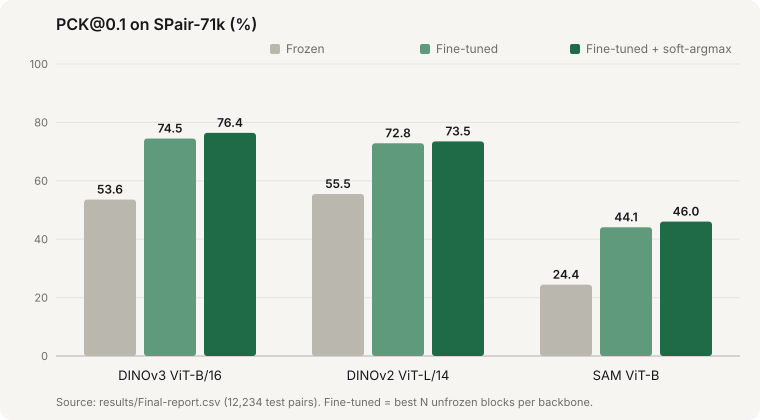

# Semantic Correspondence with Vision Transformers

Given a keypoint on one image (say, a cat's left ear), find the same point on a different image of the same category. We measured how well frozen DINOv2, DINOv3 and SAM features do this on [SPair-71k](https://cvlab.postech.ac.kr/research/SPair-71k/), then how much light fine-tuning and a better decoder add.

Fine-tuning the last 2 blocks of DINOv3 ViT-B/16 and decoding with window soft-argmax takes PCK@0.1 from **53.57% to 76.41%**.

## Results

SPair-71k test set, PCK@0.1 (%), 12,234 pairs. From [`results/Final-report.csv`](results/Final-report.csv).

| Backbone | Frozen | Fine-tuned | + soft-argmax |
| --- | ---: | ---: | ---: |
| DINOv2 ViT-L/14 (last 4 blocks) | 55.48 | 72.85 | 73.49 |
| DINOv3 ViT-B/16 (last 2 blocks) | 53.57 | 74.48 | **76.41** |
| SAM ViT-B (last 2 blocks) | 24.42 | 44.08 | 46.02 |

Zero-shot transfer to other benchmarks, frozen → fine-tuned + soft-argmax:

| Backbone | PF-Pascal | PF-Willow |
| --- | ---: | ---: |
| DINOv2 | 80.69 → 84.29 | 77.33 → 85.56 |
| DINOv3 | 86.49 → 86.04 | 85.67 → 89.22 |
| SAM | 38.92 → 49.79 | 46.11 → 55.78 |

What stood out:
- DINO features are already good without any training. SAM's segmentation encoder is much weaker at semantic matching.
- Unfreezing more blocks isn't always better. DINOv3 with 4 blocks scored 66.44, against 74.48 with 2.
- Soft-argmax helps every backbone without touching the weights.
- PF-Pascal and PF-Willow normalize PCK by image size rather than bounding box, so those numbers aren't comparable to SPair's.

## How it works

1. **Frozen baseline:** extract patch features, match the source keypoint's descriptor to every target patch by cosine similarity, take the argmax.
2. **Fine-tuning:** unfreeze the last 1, 2 or 4 blocks and train with an InfoNCE correspondence loss (AdamW, lr 5e-6, 3 epochs). The best checkpoint is picked on validation.
3. **Window soft-argmax:** take a temperature-scaled softmax in a small window around the peak for sub-patch precision. The temperature and window size are tuned on validation.
4. **Transfer:** evaluate on PF-Pascal and PF-Willow without training on them.

## Run it

Everything is in [`main.ipynb`](main.ipynb), written for Google Colab with a GPU and Google Drive for data and weights.

1. Open it in Colab (badge above) and switch the runtime to GPU.
2. Put these in `MyDrive/`:
   - `SPair-71k.tar.gz`
   - `dinov2_vitl14_pretrain_big.pth`
   - `dinov3_vitb16_pretrain_lvd1689m-73cec8be.pth`
   - `sam_vit_b_01ec64_small.pth` (this is the name `SAM_WEIGHTS_B` expects)
   - `pf-willow.zip`

   PF-Pascal downloads automatically.
3. Run the cells top to bottom. Fine-tuning skips any configuration whose checkpoint is already on Drive.

All result CSVs (per image, keypoint and category) are under [`results/`](results/).

## References

Min et al., *SPair-71k*, 2019 · Oquab et al., *DINOv2*, TMLR 2024 · [DINOv3](https://github.com/facebookresearch/dinov3) · Kirillov et al., *Segment Anything*, ICCV 2023 · Ham et al., *Proposal Flow*, CVPR 2016. Models and datasets keep their own licenses.
